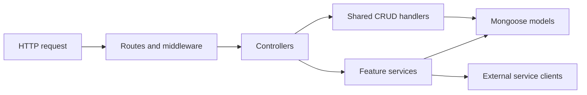

# Backend architecture

## Source layout

All application implementations live in `src/`. Files in the original root-level `controller/`, `controllers/`, `model/`, `models/`, and `routes/` directories only forward imports to the canonical implementation. This keeps contributor imports compatible without maintaining duplicate application logic.

| Location                 | Responsibility                                                      |
| ------------------------ | ------------------------------------------------------------------- |
| `src/app.js`             | Build the Express application without opening a network listener    |
| `src/server.js`          | Connect infrastructure, start HTTP, and close resources on shutdown |
| `src/config/`            | Read and validate environment settings                              |
| `src/constants/`         | Shared role and workflow vocabulary                                 |
| `src/routes/`            | Map existing HTTP paths to middleware and controllers               |
| `src/controllers/`       | Adapt request input and service results to HTTP responses           |
| `src/models/`            | Define the existing MongoDB document schemas                        |
| `src/models/plugins/`    | Model hooks such as password hashing and redaction                  |
| `src/services/`          | Coordinate feature workflows independently of HTTP                  |
| `src/services/accounts/` | Share account metadata between authentication and operator commands |
| `src/middleware/`        | Request validation, authorization, headers, and error handling      |
| `src/errors/`            | Application error types                                             |
| `src/security/`          | Password hashing and credential handling                            |
| `src/integrations/`      | External service clients                                            |
| `src/utils/`             | Small shared helpers with no startup side effects                   |
| `src/database/`          | MongoDB connection and readiness helpers                            |
| `src/lifecycle/`         | HTTP startup and graceful shutdown                                  |
| `src/cli/`               | Standard-input handling and lifecycle for operator commands         |

## Compatibility

Existing HTTP URLs, response field names, model registration names, and collection names remain part of the application contract. Database fields such as `ProjectId`, `projectid`, `Designation`, and the historical teacher password field `passoword` are intentionally preserved. Correcting source filenames does not rename stored fields.

Aliases such as `/project` and `/projects` mount the same canonical router. Case-sensitive teacher list paths retain their separate response shapes. Feature behavior and access policy changes should be separate from structural refactors.

## Conventions

- Use descriptive domain names: `ProjectModule`, `ScheduleSlot`, and `EvaluationMarks` rather than a generic `Model` in feature controllers.
- Use `kebab-case` filenames with an explicit suffix such as `.controller.js`, `.model.js`, or `.routes.js`.
- Keep shared CRUD mechanics in `controllers/crud-handlers.js`; keep feature-specific workflows explicit.
- Throw `HttpError` for expected application failures. Express async handlers forward failures to the common error middleware.
- Import canonical modules directly inside `src/`; do not import compatibility files from application implementations.
- Keep environment access and third-party SDK configuration out of feature controllers.
- Use Prettier and EditorConfig for consistent formatting. Avoid unrelated schema or API contract changes during a structural refactor.

Simple CRUD controllers use the shared handler factory directly. Multistep operations use named services, such as assigning a panel, linking a module to a deliverable, updating a schedule, or coordinating a Cloudinary upload with a database write. Services receive values rather than Express requests and return values rather than sending responses. The code does not add a repository abstraction around every Mongoose call.

## Python bridge

`jenkinsScript/jenkins.py` remains the Gunicorn entry point. `jenkinsScript/bridge/app.py` builds the Flask application. Configuration, bridge authentication, request validation, HTTP transport, XML generation, and job orchestration each have a dedicated module. Queue tracking and completed-build processing are separate functions. HTTP paths and response formats stay compatible.

## Current product boundaries

The initial structural refactor preserved collection names and contributor compatibility imports. Subsequent product fixes add project authorization, transactional proposal submission and panel operations, private local document storage, internal message delivery, project archival, and dependency upgrades. Authorization lives in `src/services/project-access.service.js`; common CRUD and specialized handlers call it before data/provider side effects. It receives the authenticated account and trusted role from middleware.

Project business identifiers and MongoDB record identifiers are selected explicitly by callers. Enrollment and submission keys use database uniqueness constraints. Child records cannot be moved between projects with general updates. Archived project identifiers remain reserved to prevent retained records from being adopted by a new team.

Application checks, MongoDB integration regressions, and browser workflow verification are enabled. All contributor branches are retained. See the README for the complete local stack and deployment configuration.
